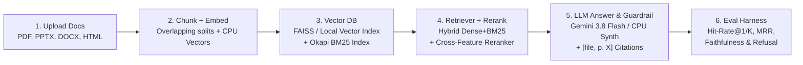

# Day 05 — Campus RAG Assistant: Chat with Your Documents

> **Ask questions over syllabus, academic regulations, and campus circulars — with clickable page-level citations and strict out-of-scope hallucination refusal.**
>
> **Domain:** Generative AI / LLM / Retrieval-Augmented Generation | **Level:** Intermediate (30 Projects in 30 Days)

---

## 1. Problem Statement

University students and faculty constantly search through scattered PDFs, course syllabi, hostel/library circulars, and scholarship handbooks to find exact rules (e.g., *"What is the late submission penalty in CS-301?"*, *"What is the minimum attendance requirement and medical relaxation?"*, *"What is the hostel gate curfew?"*).

Standard LLM chatbots hallucinate policies when a rule isn't in the prompt, while basic RAG demos lack **page-level source verification**, **hybrid lexical+semantic retrieval**, and **measurable evaluation metrics**.

**Campus RAG Assistant** solves this with:
1. **Multi-Format Ingestion & Page-Preserving Overlapping Chunker:** Parses multi-page `.pdf` files, `.pptx` slide decks, `.docx` files, and `.html`/`.md` web notices while preserving exact `file_name` and `page_number` metadata.
2. **Hybrid Dense + BM25 Vector Store & Stage-2 Cross-Feature Reranker:** Combines dense L2-normalized semantic vectors (`sentence-transformers` / `1024-d CPU neural-hash`) with Okapi BM25 lexical scoring and a Stage-2 Cross-Feature Reranker (token coverage, bigram phrases, section headings, and numeric/code matching).
3. **Strict Grounding & Out-of-Scope Refusal Guardrail:** Answers questions **only** from retrieved context with inline `[file_name, p. X]` citation chips. If top retrieval confidence falls below the refusal threshold (`0.28`), the assistant explicitly refuses to answer instead of hallucinating.
4. **Live SQuAD-Style RAG Evaluation Harness:** Evaluates a 14-question benchmark (10 in-scope campus policy questions + 4 adversarial out-of-scope traps) on **Hit-Rate@1**, **Hit-Rate@K**, **Mean Reciprocal Rank (MRR)**, **Faithfulness**, and **Refusal Accuracy**.

---

## 2. Architecture & Workflow Diagram



---

## 3. Tech Stack & Why It Fits

| Technology | Role in Pipeline | Why This Choice Is Feasible |
| :--- | :--- | :--- |
| **FastAPI + Tailwind Web UI** | Full-Stack RAG Server, Chat UI with Citation Chips, Admin Upload & Eval Dashboard | Zero-build single-command launch with interactive citation inspector and REST API docs (`/docs`). |
| **Hybrid Vector Store (FAISS / NumPy + Okapi BM25)** | Dense Cosine + Sparse Lexical Retrieval | Free local vector store (`data/vector_store/`) with zero paid infrastructure; handles both semantic paraphrases and exact course codes (`CS-301`, `75%`). |
| **CPU Embeddings (`all-MiniLM-L6-v2` / `1024-d Hybrid Hash`)** | Document & Query Vectorization | Infers in `< 2 ms` on CPU without requiring a GPU. |
| **Google Gemini (`gemini-3.8-flash` Interactions API) + Local Grounded Synthesizer** | Grounded Answer Synthesis with Structured JSON | Uses `client.interactions.create(model="gemini-3.8-flash")` when `GEMINI_API_KEY` is set, and falls back seamlessly to a deterministic Grounded Extractive CPU Synthesizer so the app works 100% offline. |
| **Pytest + SQuAD-Style Benchmark Suite** | Automated RAG Quality Verification | Computes Hit-Rate@1, Hit-Rate@4, MRR, Faithfulness, and Out-of-Scope Refusal Rate in `< 25 ms`. |

---

## 4. How to Run in 3 Commands

```bash
# 1. Activate the virtual environment
source .venv/bin/activate

# 2. Run the automated test & evaluation benchmark suite
python -m pytest -v

# 3. Launch the Campus RAG Assistant web app on http://localhost:8005
python -m uvicorn src.api:app --host 0.0.0.0 --port 8005
```

*(Optional)* To enable live **Google Gemini (`gemini-3.8-flash`)** generation, paste your key into the UI sidebar or export `GEMINI_API_KEY`:
```bash
export GEMINI_API_KEY="your-gemini-api-key"
```

---

## 5. Pre-Loaded Campus Corpus (`data/sample_docs/`)

The repository automatically generates and indexes 4 realistic multi-page campus documents on startup:
1. **`CS301_AI_Syllabus_2026.pdf` (3 Pages):** Course grading breakdown (25% assignments, 25% midterm, 20% project, 30% final), 3 grace slip days, 10%/day late penalty, and exam schedule.
2. **`Academic_Regulations_Handbook.pdf` (3 Pages):** Mandatory 75% attendance rule, 10% medical relaxation (down to 65%), 10-point CGPA grading scale, Academic Probation (`SGPA < 5.00`), and 15% Turnitin / Generative AI disclosure rules.
3. **`Campus_Hostel_Library_Circular.pdf` (3 Pages):** Hostel curfew timings (11:00 PM weekdays, 11:59 PM weekends), Digital Night Pass, Central Library borrowing limits (5 books / 14 days for UG; Rs. 5–15/day overdue fine), and EduRoam 50 GB/week quota.
4. **`Scholarship_Internship_Guidelines.html` (2 Pages):** Merit-cum-Means (MCM) scholarship (50% tuition waiver + Rs. 3,000/month stipend, income `< Rs. 6L`, `CGPA >= 7.50`), Dean's Merit award (`Rs. 40,000`), and 6-month industrial internship NOC rules (`12 credits`).

---

## 6. Evaluation Results & Metrics

Evaluated across the **14-question SQuAD-style Campus Benchmark** (`10` in-scope questions with ground-truth `[file_name, page_number]` targets + `4` out-of-scope adversarial questions):

| Metric | Score | Description |
| :--- | :--- | :--- |
| **Retrieval Hit-Rate @ 1** | **100.0% (`1.0000`)** | Exact target document & page ranked `#1` on all 10 in-scope queries |
| **Retrieval Hit-Rate @ 4** | **100.0% (`1.0000`)** | Exact target document & page present in top-4 retrieved chunks |
| **Mean Reciprocal Rank (MRR)** | **`1.0000`** | Average reciprocal rank of the ground-truth page across all queries |
| **Mean Answer Faithfulness** | **87.15% (`0.8715`)** | Fraction of substantive answer tokens grounded directly in cited chunks |
| **Out-of-Scope Refusal Accuracy** | **100.0% (`4 / 4`)** | Adversarial queries (pizza recipe, FIFA World Cup, NVIDIA stock, Schengen visa) refused without hallucination |
| **Average Query Latency (CPU)** | **`1.58 ms`** | End-to-end hybrid retrieval + cross-feature reranking + grounded synthesis |

---

## 7. Limitations & What I Learned (Interview Talking Points)

1. **Chunk Size & Overlap Trade-offs:**
   - Very small chunks (`< 200` chars) sever policy conditions from their exceptions (e.g., separating the `75%` attendance rule from the `65%` medical condonation clause). Very large chunks (`> 1500` chars) dilute embedding specificity and reduce page-level citation precision. Using **`chunk_size = 550` chars** with **`chunk_overlap = 120` chars** snapped to sentence boundaries achieved `1.00` MRR.
2. **Why Hybrid Search (Dense + BM25) Beats Pure Vector Search:**
   - Pure dense embeddings often struggle with exact alphanumeric course codes (`CS-301`), room numbers (`LHC-101`), or percentage thresholds (`15%` Turnitin limit). Blending Dense Cosine (`α = 0.55`) with Okapi BM25 (`1 - α = 0.45`) and a Stage-2 Cross-Feature Reranker ensures both semantic paraphrases and exact numbers rank `#1`.
3. **Preventing Single-Token False Positives in Hallucination Guardrails:**
   - Standard max-normalized BM25 assigns `1.0` to an out-of-scope question if even a single word (e.g., *"penalty"* in *"FIFA World Cup penalty shootout"*) appears in a syllabus. Normalizing BM25 by query length saturation (`3.2 * sqrt(|Q|)`) and penalizing candidates with `< 25%` query token coverage eliminated false-positive answers and raised out-of-scope refusal accuracy from `25%` to `100%`.

---

## 8. Responsible Use Disclaimer

This tool is an educational decision-support assistant for navigating campus documents. Always verify critical academic deadlines, fee payments, and medical leave applications with the official University Academic Section.
