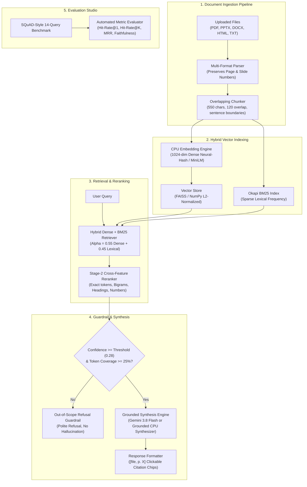

# Architecture & System Design — Campus RAG Assistant

This document outlines the architecture, data flow, indexing pipeline, and evaluation harness of the **Campus RAG Assistant** (Day 05 of the 30 Projects in 30 Days Challenge).

---

## 1. System Overview

Campus RAG Assistant is an end-to-end, privacy-preserving Retrieval-Augmented Generation (RAG) assistant designed for universities and academic institutions. It enables students and faculty to query course syllabi, university regulations handbooks, campus circulars, and scholarship guidelines with **exact page-level citations** while enforcing **strict hallucination guardrails**.

---

## 2. Ingestion & Document Parser (`src/document_parser.py`)

Unlike simplistic RAG demos that discard page breaks upon reading text, Campus RAG Assistant preserves exact document physical page numbers across all supported file types:
- **PDF Extraction:** Parses PDF literal streams and text operators (`Tj`, `TJ`, `'`) in pure Python, decoding font encodings and unescaping characters without external binary dependencies. Also falls back gracefully to `pypdf` or `PyMuPDF` if available.
- **PPTX Slide Decks:** Unpacks PowerPoint XML trees (`ppt/slides/slideN.xml`) and treats each slide as an individual page.
- **DOCX Word Documents:** Extracts paragraph structures from `word/document.xml` into structured virtual pages.
- **HTML / Webpages:** Cleans DOM trees of scripts/styles using Python's `html.parser.HTMLParser` and tracks structured section headings.

### Overlapping Chunker Algorithm
- **Target chunk size:** `550` characters.
- **Chunk overlap:** `120` characters.
- **Boundary preservation:** Snaps to the nearest period, newline, or whitespace boundary to prevent cutting sentences mid-clause.
- **Metadata tagging:** Every chunk retains `file_name`, `page_number`, `chunk_index`, and `section_title`.

---

## 3. Hybrid Retrieval & Cross-Feature Reranker (`src/vector_store.py`)

### Dual-Stage Retrieval Pipeline
1. **Stage 1 — Hybrid Retrieval (Dense Cosine + Sparse BM25):**
   $$\text{Score}_{\text{hybrid}} = \alpha \cdot \text{Score}_{\text{dense}} + (1 - \alpha) \cdot \text{Score}_{\text{BM25}}$$
   - $\alpha = 0.55$: Gives balanced weight to semantic paraphrases while respecting exact alphanumeric course codes (`CS-301`, `75%`, `Rs. 3,000`).
   - BM25 is normalized against query-length saturation ($3.2 \times \sqrt{|Q|}$) to prevent single random word matches from spiking lexical scores on out-of-scope queries.

2. **Stage 2 — Cross-Feature Reranking:**
   Candidate chunks from Stage 1 are re-scored using 5 explainable features:
   - **Lexical Coverage:** Ratio of query content tokens present in chunk vocabulary ($30\%$).
   - **Bigram Phrase Hits:** Ordered word-pair matches ($15\%$).
   - **Title Alignment:** Matches against section headings ($15\%$).
   - **Numeric / Code Matches:** Exact matches for course codes, dates, percentages ($12\%$).
   - **Hybrid Base Score:** Stage 1 combined score ($45\%$).
   - **Coverage Penalty:** Chunks with $< 25\%$ query coverage or single-word accidental matches on multi-token queries receive a $0.35\times$ penalty multiplier.

---

## 4. Grounded Synthesis & Hallucination Guardrail (`src/rag_engine.py`)

### Out-of-Scope Hallucination Refusal Policy
When top retrieval confidence falls below `0.28` or when zero core query tokens match the corpus vocabulary, the assistant refuses to generate an ungrounded answer:
- Refuses questions about unrelated topics (recipes, sporting events, stock market, external visas).
- Reports the low confidence score and lists currently indexed campus documents.

### Model Providers
1. **Google Gemini (`gemini-3.8-flash`):** Supported via the official `google-genai` Interactions API (`client.interactions.create`) with structured JSON schema output when a `GEMINI_API_KEY` is provided.
2. **Grounded Extractive CPU Synthesizer:** Deterministic local synthesis engine that extracts the highest-scoring supporting sentences across the top-ranked chunks and attaches inline `[file_name, p. X]` citations. Runs in under `2 ms` on CPU with zero network calls.

---

## 5. Evaluation Harness (`src/evaluator.py`)

Evaluated continuously using a 14-question SQuAD-style benchmark (10 in-scope syllabus/regulations queries with ground-truth citations + 4 adversarial out-of-scope queries):
- **Hit-Rate @ 1:** Measures if the ground-truth document & page rank as `#1`.
- **Hit-Rate @ K:** Measures if the ground-truth document & page exist in the top-K retrieved chunks.
- **Mean Reciprocal Rank (MRR):** Computes $\frac{1}{|Q|}\sum \frac{1}{\text{rank}_i}$.
- **Faithfulness Score:** Evaluates what fraction of generated answer tokens are directly supported by cited source chunks.
- **Out-of-Scope Refusal Accuracy:** Measures hallucination prevention rate on unanswerable queries.
